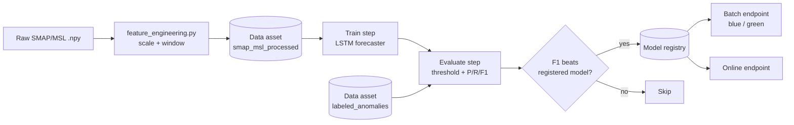

# Satellite Telemetry Anomaly Detection — MLOps on Azure ML

An end-to-end MLOps project that trains, evaluates, registers and deploys LSTM anomaly-detection models for spacecraft telemetry, using the NASA SMAP/MSL dataset and Azure Machine Learning.

Each telemetry channel gets its own model. The model forecasts the next telemetry value from a sliding window of past readings, and a point is flagged as an anomaly when the forecast error exceeds a threshold derived from the training errors.

The focus of the project is the pipeline around the model: versioned data assets, a reproducible training environment, experiment tracking, a gated model registry, batch and online endpoints with blue/green deployments, and automated retraining.

## Architecture



Training and evaluation run as a two-step Azure ML pipeline on a compute cluster. Registration is a separate step that runs after the pipeline completes and only registers the model if its F1 beats the latest registered version.

## Repository layout

```
.github/workflows/train_pipeline.yml   CI workflow that submits the pipeline
automation/orchestrate.py              Local watcher: new data -> train -> register -> batch score
environments/training/                 Dockerfile + scripts to register the environment, datastore and raw data asset
pipelines/pipeline.py                  Azure ML pipeline definition (train -> evaluate)
src/data/                              Feature engineering, data asset registration, hyperparameter sweep
src/training/                          Training script and model registration
src/evaluation/                        Evaluation (pipeline step and standalone version)
src/deployment/                        Batch/online endpoint deployment and scoring scripts
analyse_predictions.py                 Compares batch predictions to ground-truth labels
download_models_backup.py              Downloads registered models to model_backups/
```

## How it works

### Data

The project uses the [NASA SMAP/MSL telemetry dataset](https://github.com/khundman/telemanom) (Hundman et al., 2018). Three channels are processed: `P-1`, `E-13` and `F-7`.

[src/data/feature_engineering.py](src/data/feature_engineering.py) scales each channel to `[-1, 1]` with a `MinMaxScaler` fitted on the training split, then builds sliding windows of 100 timesteps. The target for each window is the next value of the telemetry feature (column 0). The output is `X_train`, `y_train`, `X_test` and `y_test` per channel.

The processed data and the ground-truth labels (`labeled_anomalies.csv`) are registered as versioned Azure ML data assets, `smap_msl_processed` and `labeled_anomalies`.

### Model

[src/training/train.py](src/training/train.py) trains a single-layer LSTM followed by a dense output, with the Adam optimizer and MSE loss. Parameters and per-epoch losses are logged to MLflow in the Azure ML workspace.

[src/data/sweep.py](src/data/sweep.py) runs a grid sweep over `batch_size` (16, 32, 64) and `lstm_units` (32, 64, 128), minimizing the final validation loss.

### Evaluation

[src/evaluation/evaluate_step.py](src/evaluation/evaluate_step.py) computes the anomaly threshold from the training errors only:

```
threshold = mean(train_errors) + 3.0 * std(train_errors)
```

It applies that threshold to the test errors, compares the flagged points to the labelled anomaly ranges, and writes precision, recall, F1 and the threshold to `metrics.json`.

### Registration

[src/training/local_register.py](src/training/local_register.py) downloads `metrics.json` from a finished pipeline job and registers the model only if there is no registered version yet or the new F1 is higher. The model is registered straight from the job's output path, which keeps the job-to-model lineage in Azure ML Studio. Metrics and the threshold are stored as model tags.

### Deployment

| Script | What it does |
| --- | --- |
| [deploy_batch_endpoint.py](src/deployment/deploy_batch_endpoint.py) | Creates a batch endpoint with a `blue` deployment and makes it the default |
| [deploy_green_deployment.py](src/deployment/deploy_green_deployment.py) | Adds a `green` deployment to an existing batch endpoint without sending it traffic |
| [switch_default_deployment.py](src/deployment/switch_default_deployment.py) | Switches the endpoint's default deployment (blue to green) |
| [invoke_batch_endpoint.py](src/deployment/invoke_batch_endpoint.py) | Submits a batch scoring job |
| [deploy_online_endpoint.py](src/deployment/deploy_online_endpoint.py) | Creates a managed online endpoint for real-time scoring |

Deployments read the threshold from the registered model's tags and pass it to the scoring script as the `ANOMALY_THRESHOLD` environment variable. The batch endpoint writes its forecasts to `predictions.csv`.

### Automation

- **GitHub Actions** — [train_pipeline.yml](.github/workflows/train_pipeline.yml) submits the pipeline on a push to `main`, on manual dispatch, or on a `new-data` repository dispatch event sent by an Azure Logic App when new data arrives. It runs on a self-hosted Windows runner.
- **Local orchestrator** — [automation/orchestrate.py](automation/orchestrate.py) watches `src/data/raw/` for new files and then runs the whole chain: submit the pipeline, register the model if it is better, and invoke the batch endpoint.

## Getting started

### Prerequisites

- Python with the packages in [requirements.txt](requirements.txt)
- An Azure subscription with an Azure ML workspace, a compute cluster and a storage account
- The Azure CLI, signed in with `az login` (the scripts authenticate with `DefaultAzureCredential`)

```bash
pip install -r requirements.txt
```

### Configuration

The Azure identifiers are constants at the top of each script. `SUBSCRIPTION_ID` and `TENANT_ID` are left blank in the repository; fill them in locally and do not commit them:

```python
SUBSCRIPTION_ID = "..."
RESOURCE_GROUP = "..."
WORKSPACE_NAME = "..."
TENANT_ID = "..."
```

The scripts also expect a compute cluster named `anomaly-compute-cluster`. The channel to train or deploy is set by the `CHANNEL_NAME` constant in each script.

### Data

The dataset is not included in this repository. Download it from the [telemanom](https://github.com/khundman/telemanom) project and arrange it as:

```
src/data/raw/train/<channel>.npy
src/data/raw/test/<channel>.npy
src/data/raw/labeled_anomalies.csv
```

### Run it

Several scripts use relative paths, so run each one from the directory shown.

```bash
# 1. Register the training environment (built from the Dockerfile)
cd environments/training
python 01_register_env.py

# 2. Build the windowed dataset (from the repository root)
cd ../..
python src/data/feature_engineering.py

# 3. Register the processed data and the labels as data assets
cd src/data
python register_dataset_sdk.py
python register_labels.py

# 4. Submit the train + evaluate pipeline
cd ../../pipelines
python pipeline.py

# 5. Once the job completes, register the model if it beats the current one
cd ../src/training
python local_register.py --job_name <job_name_printed_by_pipeline.py>

# 6. Deploy and score
cd ../deployment
python deploy_batch_endpoint.py
python invoke_batch_endpoint.py
```

Optional steps:

```bash
cd src/data && python sweep.py                   # hyperparameter sweep
cd automation && python orchestrate.py           # watch for new data and run the full chain
python analyse_predictions.py                    # compare batch predictions to the labels
python download_models_backup.py                 # back up registered models locally
```

## Results

Point-wise metrics on the test split for the registered models:

| Channel | Precision | Recall | F1 | Threshold |
| --- | --- | --- | --- | --- |
| P-1 | 0.073 | 0.021 | 0.033 | 0.442 |
| F-7 | 0.190 | 0.073 | 0.106 | 1.132 |

The model is a simple baseline and these scores are low. Scoring is strictly point-by-point with a single static threshold, which is much stricter than the range-based scoring commonly reported for this dataset.

## Known limitations

- Azure identifiers and the channel name are hard-coded in each script instead of living in a shared config.
- The CI workflow depends on a self-hosted runner with a local virtual environment at a fixed path, and it changes into `src\pipeline` while the pipeline script is in `pipelines/`. The runner could not be started on the development machine, so `automation/orchestrate.py` is the trigger that was actually used.
- The online endpoint scripts are included but were never deployed, because the subscription had no CPU quota for online endpoints. Scoring was done through the batch endpoints.
- Registration runs locally after the pipeline rather than as a pipeline step, because the compute cluster's identity cannot write to the model registry. `src/training/register_step.py` is the unused in-pipeline version.
- `src/evaluation/evaluate.py` is an earlier standalone version of the evaluation step; the pipeline uses `evaluate_step.py`.
- Only P-1 and F-7 have registered models and batch endpoints; E-13 was trained but not deployed.
- There is no drift detection, alerting or automated monitoring.
- `tests/`, `configs/` and `notebooks/` are placeholders.
- The batch scoring script outputs forecasts only; anomaly flags are computed afterwards by `analyse_predictions.py`.

## Acknowledgements

Dataset and original method: Hundman et al., *Detecting Spacecraft Anomalies Using LSTMs and Nonparametric Dynamic Thresholding*, KDD 2018.
